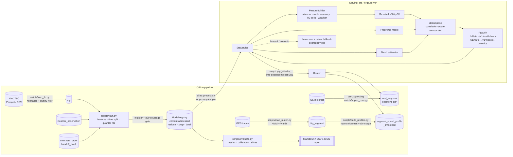

# ETA Forge

ETA Forge is an ETA prediction service for a ride-hail or food-delivery marketplace. It
uses the two-stage design Uber has described publicly:

1. **A physical baseline.** pgRouting runs a shortest-path search over an OSM road graph
   in PostGIS. Each edge's cost is computed at query time from mined
   time-of-day × day-of-week speed profiles, so a route at 08:00 Monday and one at
   03:00 Sunday are priced on different graphs.
2. **A learned correction.** LightGBM quantile models predict the *residual* between
   that baseline and the observed trip duration, at p50 and p90. The residual covers
   what the router misses: turn and signal costs, local hotspots, rain.

Delivery ETAs are split into `prep + travel + handoff`. Prep time comes from a
per-merchant model and handoff dwell from a per-destination-cell model. The three
components are combined with a correlation-aware tail composition, because adding three
p90s produces a heavily padded ETA.

```
ETA = merchant prep  +  travel  +  handoff dwell
                         │
                         └── baseline (pgRouting over profiled edge costs)
                             + residual correction (quantile model, p50 / p90)
```

## Architecture



## Repository layout

| Path | What lives there |
|---|---|
| `eta_forge/types.py`, `config.py` | Domain types; layered config (YAML < `ETA_FORGE_*` env < `--set`) |
| `eta_forge/db/` | DSN, lazy psycopg pool, `SqlRunner` with dry-run, checksummed migrations |
| `sql/001-008` | PostGIS / pgRouting / h3 schema, indexes, routing and profile functions, weather |
| `eta_forge/graph/` | Cost-SQL composition, pgRouting router, turn analysis, route summary, synthetic grid |
| `eta_forge/data/` | TLC loader and quality filter, seeded synthetic world |
| `eta_forge/mapmatch/` | Candidate sources, HMM/Viterbi matcher, traversal attribution |
| `eta_forge/profiles/` | Local-time bucketing, harmonic-mean mining, hierarchical shrinkage, staging-swap store |
| `eta_forge/features/` | Hashed `FeatureSpec`, feature builder, calendar, H3 cells, target encoding, weather join |
| `eta_forge/models/` | Quantile backends, time splits, residual / prep / dwell models, registry |
| `eta_forge/service.py`, `decompose.py` | Request path and quantile composition |
| `eta_forge/api/`, `server.py` | FastAPI app, pure-Python schemas, Prometheus metrics, entrypoint |
| `eta_forge/eval/` | Metrics, calibration, slices, harness, report writer |
| `scripts/` | Operator CLIs: migrate, import, load, match, profile, train, evaluate, smoke |
| `deploy/` | Docker Compose with PostGIS 16 + pgRouting + h3-pg, API image |

## Design decisions

- **The router minimises seconds, not metres.** The cost SQL is `length / speed`, where
  speed comes from the smoothed profile cell, then a damped speed limit, then the class
  default. All values are inlined as validated numeric literals because the cost SQL sits
  inside a dollar-quoted `pgr_dijkstra` argument.
- **Profiles use harmonic means.** Speeds over a fixed distance average harmonically. An
  arithmetic mean makes every baseline optimistic, and the error is largest at rush hour.
- **Sparse cells are shrunk.** Each sparse cell is shrunk toward neighbouring hours, then
  the segment's own mean, then the class × time-of-day mean, then the class default.
  Every level uses the weight `n / (n + k)`. A cell is trusted for routing based on its
  *effective* sample count.
- **The learner predicts residuals, not durations.** Without a model, the baseline is
  still a valid ETA.
- **Splits are by time, and target encoding is out of fold.** Training rows get
  past-only encodings. Validation and test rows are encoded with statistics from the
  training rows only.
- **Promotion is gated on p90 coverage.** If held-out coverage falls outside
  `model.promote_coverage_band`, the model is not promoted.
- **Answers degrade instead of failing.** A routing timeout or a missing model still
  returns an ETA, with `degraded: true` and the reason.
- **Heavy dependencies load lazily.** `psycopg`, `lightgbm`, `numpy`, `pandas`, `h3`,
  `fastapi` and `pyarrow` are imported only inside the functions that use them. Every
  module imports on a bare interpreter. A pure-Python quantile booster
  (`model.backend: stumps`) lets the whole pipeline run without LightGBM.

## How to run

### 1. Without a database (synthetic world)

You only need Python 3.11+ and PyYAML (PyYAML is needed only to read the config file).

```bash
python -m venv .venv && source .venv/bin/activate
pip install pyyaml

# The whole pipeline end to end: generate trips, map-match, mine profiles, train,
# register, serve, evaluate, write the report.
python scripts/smoke_end_to_end.py --out-dir artifacts/smoke

# The individual stages, all on synthetic data:
python scripts/map_match.py --synthetic --trips 200          # matcher scored against ground truth
python scripts/build_profiles.py --synthetic                 # mine + shrink speed profiles
python scripts/train.py --synthetic --backend stumps         # register + gate + promote
python scripts/evaluate.py --synthetic                       # report in artifacts/eval/
```

Serve the trained models on the synthetic grid (requires `fastapi` and `uvicorn`):

```bash
pip install fastapi 'uvicorn[standard]'
python -m eta_forge.server --config configs/eta_forge.yaml --synthetic --port 8080

curl -s localhost:8080/v1/eta -H 'content-type: application/json' -d '{
  "origin": {"lat": 40.7005, "lon": -74.0095},
  "destination": {"lat": 40.7320, "lon": -73.9650},
  "departure_at": "2024-01-03T17:30:00-05:00"
}'

curl -s localhost:8080/v1/eta/delivery -H 'content-type: application/json' -d '{
  "origin": [40.7100, -74.0000], "destination": [40.7300, -73.9700],
  "merchant_id": "m0003", "order_item_count": 3, "open_orders_at_merchant": 5
}'

curl -s 'localhost:8080/v1/route?origin=40.7005,-74.0095&destination=40.7320,-73.9650'
curl -s localhost:8080/v1/models
curl -s -X POST localhost:8080/v1/models/reload
curl -s localhost:8080/metrics
```

To pin a specific residual version for one request (for shadow comparison), add
`"model_version": "residual/20260824T1200Z-a1b2c3d4"` to the request body.

### 2. Against PostGIS + pgRouting (operator steps)

```bash
pip install -r requirements.txt               # plus the osm2pgrouting binary

# Database: PostGIS 16-3.4 with pgRouting and h3-pg. The initdb hook applies sql/.
docker compose -f deploy/docker-compose.yml up -d db
python scripts/migrate.py --status            # or --dry-run to print the SQL

# Road graph from an OSM extract (data/osm/new-york.osm.pbf by default).
python scripts/import_osm.py --dry-run        # shows the exact commands first
python scripts/import_osm.py

# Trips, traces, profiles.
python scripts/load_tlc.py data/tlc/yellow_tripdata_2015-*.parquet
python scripts/map_match.py --since 2015-01-01T00:00:00+00:00
python scripts/build_profiles.py --days 90

# Train, gate, promote; then evaluate on a later window.
python scripts/train.py --since 2015-01-01T00:00:00+00:00 --until 2015-04-01T00:00:00+00:00
python scripts/evaluate.py --since 2015-04-01T00:00:00+00:00 --until 2015-05-01T00:00:00+00:00

# Database + API together (models are mounted read-only from ./artifacts).
docker compose -f deploy/docker-compose.yml up --build
```

Every database-touching script accepts `--dry-run`, which prints the SQL instead of
executing it. Configuration can be overridden by environment
(`ETA_FORGE_DATABASE__HOST=db`) or on the command line
(`--set model.backend=lightgbm`).

### Model registry

Models live under `model.registry_dir` (default `artifacts/models`) as immutable,
content-addressed versions such as `residual/20260824T1200Z-a1b2c3d4`. Each version has a
`manifest.json` that records the feature-spec hash, training window, row counts,
parameters, held-out metrics and git sha. Aliases are stored in `aliases.json` and
updated atomically. A version can be loaded by id, as `name@alias`, or as a bare name
(which resolves to the `production` alias). `ModelRegistry.rollback("residual")`
re-points the alias to the previous version.

## How to test

The unit tests use only the standard library. They need no database, no network, no
LightGBM and no FastAPI:

```bash
python -m unittest discover -s tests -t .
```

The suite covers:

- geometry, turn classification, cost-SQL composition, route summaries (`test_geometry`,
  `test_turns`, `test_costs`, `test_route_summary`)
- the TLC loader across schemas, the quality filter, the HMM matcher and traversal
  attribution (`test_tlc_loader`, `test_quality`, `test_hmm`)
- bucketing including DST, harmonic-mean mining, hierarchical shrinkage (`test_buckets`,
  `test_mining`, `test_shrinkage`)
- feature-spec drift detection, calendar and holidays, out-of-fold target encoding, time
  splits (`test_feature_spec`, `test_calendar`, `test_target_encoding`, `test_splits`)
- the quantile booster's coverage, prep and dwell models, the registry's atomicity and
  rollback (`test_quantile`, `test_prep_time`, `test_registry`)
- quantile composition, evaluation metrics, calibration, slices, reports (`test_decompose`,
  `test_eval_metrics`, `test_calibration`, `test_slices`, `test_report`)
- API validation and metrics, the full service path including degraded fallbacks
  (`test_api_schemas`, `test_service`)
- an import-safety check that loads every module in a fresh interpreter and asserts
  that no heavy dependency was imported (`test_import_safety`)

To run one module, e.g. `python -m unittest tests.test_hmm -v`. For an integration
check, use `python scripts/smoke_end_to_end.py`. It asserts invariants at every stage
(the residual model beats routing-only, the delivery p50 is the sum of its components,
the composed p90 does not exceed the naive sum, model pinning is honoured) and exits
non-zero on the first violation. For a quick syntax check, run
`python -m compileall -q eta_forge scripts tests`.
